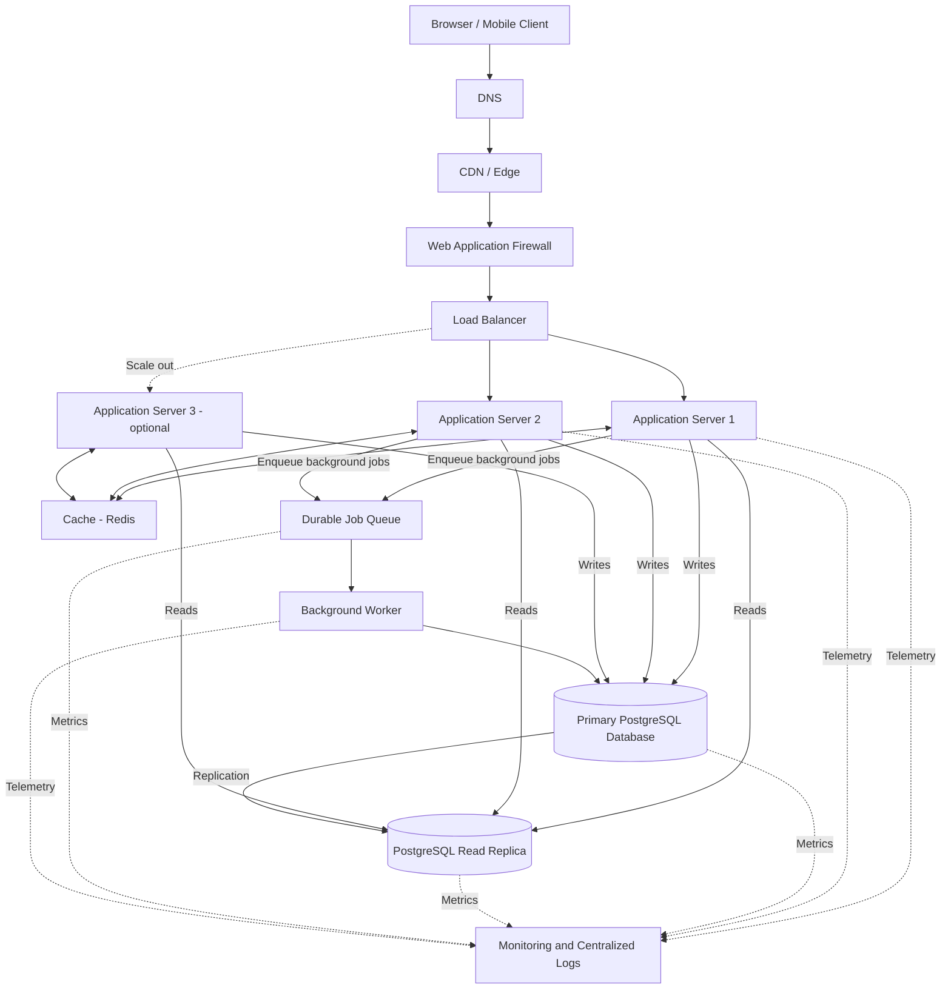

# QuickNotes System Architecture

## 1. Purpose

This document proposes a production architecture for QuickNotes as it
evolves from a browser-only demonstration into an online note-taking
service for one million registered users.

The architecture is a proposed design, not a claim that the current
JSONPlaceholder client already has these backend components.

## 2. Functional requirements

The system must:

1. Allow users to register and authenticate securely.
2. Create notes with a required title of at most 100 characters.
3. List notes belonging to the authenticated user.
4. Retrieve an individual note.
5. Update and delete notes.
6. Create tags and assign multiple tags to notes.
7. Support pagination for large note collections.
8. Validate input and return consistent error responses.
9. Prevent users from accessing or modifying another user's notes.
10. Return meaningful loading, success, empty, and error states to the client.

## 3. Non-functional requirements

### Availability

Target an initial service availability objective of 99.9% per month,
excluding agreed maintenance windows. This is a proposed objective,
not a measured guarantee.

### Performance

- Target p95 response time below 300 ms for ordinary cached reads.
- Target p95 response time below 500 ms for ordinary database-backed reads.
- Target p95 response time below 500 ms for simple note writes under normal load.
- Set explicit timeouts and resource limits for external dependencies.

These targets must be validated with load testing.

### Scalability

The service should support one million registered users, horizontal
application-server scaling, pagination, caching, and database read
replicas.

### Security

Use HTTPS, secure authentication, server-side validation, ownership
checks, rate limiting, secrets management, and least-privilege access.

### Reliability and recovery

- Use automated database backups and regularly test restoration.
- Define recovery point objective (RPO) and recovery time objective (RTO).
- Monitor replication lag, queue depth, errors, latency, and resource usage.
- Make background jobs retryable and safe to execute more than once.

### Maintainability

Keep API handlers, business logic, database access, and background
processing logically separated. Use automated tests, version-controlled
migrations, and centralized logs.

## 4. Load estimates for one million users

These are planning estimates, not measured traffic. They assume:

- 1,000,000 registered users.
- 20% of registered users are active on an average day: 200,000 DAU.
- Each daily active user makes 100 read requests per day.
- Each daily active user makes 10 write requests per day.
- Traffic is distributed across 86,400 seconds per day.
- Peak traffic can reach 10 times the daily average.
- Each new note averages 1 KB of stored content and metadata.
- Each daily active user creates 2 new notes per day.
- One year contains 365 days.

### Reads per second

Daily reads:

200,000 users × 100 reads = 20,000,000 reads/day.

Average read rate:

20,000,000 ÷ 86,400 = approximately 231 reads/second.

Estimated peak read rate:

231 × 10 = approximately 2,315 reads/second.

### Writes per second

Daily write requests:

200,000 users × 10 writes = 2,000,000 writes/day.

Average write rate:

2,000,000 ÷ 86,400 = approximately 23 writes/second.

Estimated peak write rate:

23 × 10 = approximately 230 writes/second.

Writes include creates, updates, and deletes. Only note creation
contributes to the new-note storage estimate below.

### Storage per year

Assume 200,000 daily active users each create 2 notes per day.

New notes per year:

200,000 × 2 × 365 = 146,000,000 notes/year.

At an average of 1 KB per note:

146,000,000 × 1 KB = approximately 146 GB/year of raw note data,
using decimal units.

This excludes database indexes, tags, user records, logs, backups,
replicas, and storage overhead. If all these factors add 2–3 times
the raw note data, planning storage might be approximately 292–438 GB
per year for note data and its associated database overhead.

Actual storage will depend on average body length, metadata, index size,
retention, compression, and backup policies.

### Summary table

| Metric                    | Estimated average | Estimated peak |
| ------------------------- | ----------------: | -------------: |
| Read requests/second      |               231 |          2,315 |
| Write requests/second     |                23 |            230 |
| New notes/year            |       146 million | Not applicable |
| Raw new-note storage/year |            146 GB | Not applicable |

These estimates exclude anonymous traffic, automated clients, and
additional background reads or writes. Revisit the model using real
production metrics before selecting final capacity.

## 5. High-level architecture diagram

The diagram shows the logical architecture. In a production deployment,
the edge, application, cache, queue, and database layers should use
redundant instances or managed high-availability configurations.

## 6. Component responsibilities

### Browser or mobile client

Provides the user interface and sends HTTPS requests to the API. It
validates input for usability, but the server remains responsible for
security and authoritative validation.

### DNS

Resolves the public service hostname to the appropriate edge endpoint.
Use a reliable DNS provider, health-aware routing where appropriate,
and protected account access.

### CDN / edge

Caches eligible static assets close to users and reduces latency and
origin traffic. Private note responses must not be shared through a
public cache.

### Web application firewall

Filters common malicious HTTP requests and can apply protective rules
and rate limits. It reduces risk but does not replace application
security controls.

### Load balancer

Distributes requests across healthy application servers and stops
sending traffic to unhealthy instances.

### Application servers

Validate requests, authenticate users, enforce ownership, execute
business rules, and communicate with the cache, database, and queue.
Run at least two instances across separate failure domains.

### Cache (Redis)

Stores short-lived, frequently requested data and can reduce database
read pressure. Cache keys must include the correct user or access scope
where data is private.

### Primary PostgreSQL database

The authoritative source of truth for notes, users, tags, and
relationships. It handles transactional writes and integrity checks.

### Read replica

Serves suitable read-only queries, reducing load on the primary.
Replication may be asynchronous, so recent writes may not be visible
immediately. Read-after-write requests can be routed to the primary.

### Durable job queue

Stores background work such as notifications, audit processing, or
other tasks that should not delay a user-facing request. Jobs should
remain available for retry after transient failures.

### Background worker

Consumes queued jobs, processes them, records outcomes, and retries
recoverable failures with backoff. Workers must be designed for
at-least-once delivery and idempotent processing.

### Monitoring and centralized logs

Collects latency, error rates, saturation, database health, queue depth,
and structured logs. Alerts help operators detect failures and respond
before they become prolonged outages.

## 7. Request flow: GET /v1/notes

1. The client resolves the API hostname through DNS and establishes an
   HTTPS connection to the edge.
2. The CDN and web application firewall process the request. Private
   note data is not served from a shared public cache.
3. The load balancer selects a healthy application-server instance.
4. The application server validates the access token and determines
   the authenticated user's identity.
5. The server validates pagination parameters and constructs a
   user-scoped cache key.
6. The application checks Redis for a valid cached result. If a safe,
   current result exists, it can return that result.
7. On a cache miss, the application queries PostgreSQL using the
   authenticated user's ID and the requested pagination parameters.
8. Suitable read-only queries may use the read replica. Queries
   requiring read-after-write consistency use the primary.
9. The application maps the result to the documented JSON response
   and caches the result when appropriate.
10. The server returns `200 OK` with the notes and pagination metadata.
11. Metrics and structured logs record the request outcome without
    exposing tokens or sensitive note content.

An empty result returns `200 OK` and an empty data array. An invalid
token returns `401 Unauthorized`.

## 8. Request flow: POST /v1/notes

1. The client submits a JSON body containing the title and optional
   body over HTTPS.
2. DNS, the edge, the web application firewall, and the load balancer
   route the request to a healthy application server.
3. The server validates the access token and derives the user identity.
4. The server validates the JSON content type, request size, title,
   and body.
5. The application executes a parameterized SQL INSERT against the
   primary PostgreSQL database.
6. The database enforces constraints and commits the transaction.
   The application obtains the generated ID and timestamps.
7. The application invalidates or updates affected cache entries so
   stale note lists are not served indefinitely.
8. If follow-up background work is required, the application publishes
   a durable job using a reliable delivery design, such as a
   transactional outbox.
9. The server returns `201 Created`, the new note representation, and
   a `Location` header.

The primary database is authoritative. The application must not report
a note as successfully created until the transaction has committed.
If a cache invalidation or queue publication fails, the design must
include retries or recovery rather than silently losing the work.

## 9. Architecture trade-offs

### Trade-off 1: Cache performance versus consistency

Caching reduces repeated database reads and can lower latency. However,
a cached list can become stale after a note is created, edited, or
deleted.

Mitigation: use short TTLs, explicit invalidation, user-scoped cache
keys, and primary reads for operations requiring read-after-write
consistency. Never treat the cache as the source of truth.

### Trade-off 2: Read replicas versus immediate consistency

Read replicas increase read capacity and isolate read traffic from
writes. However, asynchronous replication can cause a recently created
note to be missing from a replica response.

Mitigation: route read-after-write requests to the primary, monitor
replication lag, and use the replica only where eventual consistency
is acceptable.

### Trade-off 3: Background processing versus operational complexity

A queue allows slow tasks to run outside the request path. It adds
infrastructure and introduces retries, duplicate delivery, and possible
processing delays.

Mitigation: use durable queues, idempotent workers, retry backoff,
dead-letter handling, monitoring, and a transactional outbox for
database changes that must reliably trigger jobs.

### Trade-off 4: SQL transactions versus horizontal write scaling

PostgreSQL transactions and constraints provide strong integrity for
related records. A single primary can eventually become a write
bottleneck, while distributed writes introduce complexity.

Mitigation: optimize queries, indexes, connection pooling, and
transaction duration first. Scale the primary vertically as appropriate
and consider partitioning or sharding only when measured workloads
justify it.

## 10. Avoiding single points of failure

A design with multiple app servers is not automatically highly
available. Every critical dependency must be considered.

- **Application servers:** Run at least two instances across separate
  availability zones or failure domains and use health checks.
- **Load balancing:** Use a managed or redundant load-balancing service
  with health checks and resilient configuration.
- **DNS and edge:** Use a reliable provider, protect account access,
  and establish recovery procedures for configuration errors.
- **Cache:** Use a highly available cache deployment or accept cache
  bypass during failures. Cache failure must not corrupt authoritative data.
- **Primary database:** Configure automated failover to an eligible
  standby or replica, durable backups, and tested restoration procedures.
  A read replica is not a complete backup.
- **Queue:** Use durable, replicated queue storage and monitor
  unprocessed messages and delivery failures.
- **Workers:** Run multiple worker instances and use safe retry logic.
- **Secrets and configuration:** Back up and protect configuration,
  and test restoration of required credentials.
- **Monitoring:** Keep alerting and telemetry available independently
  of individual application instances.

Database failover, queue recovery, and regional disaster recovery
require explicit procedures and testing. They should not be assumed
to happen correctly merely because replicas exist.

## 11. Delivery and deployment strategy

1. Build and test the API and database migrations in a development environment.
2. Run automated unit, integration, security, and API-contract tests.
3. Deploy to staging and run load tests using realistic request patterns.
4. Deploy using a rolling or blue-green strategy with health checks.
5. Monitor error rate, latency, saturation, replication lag, and queue depth.
6. Roll back application releases when health checks or error budgets
   indicate an unacceptable regression.
7. Test database backup restoration and failover procedures regularly.

## 12. Conclusion

The proposed design separates the browser client, stateless application
servers, cache, durable job processing, and relational database. It
provides a path to support one million registered users while keeping
the database authoritative and scaling read capacity independently.

All traffic estimates and performance targets are hypotheses to validate.
Final production capacity, availability guarantees, and recovery
objectives must be established through testing and operational evidence.
